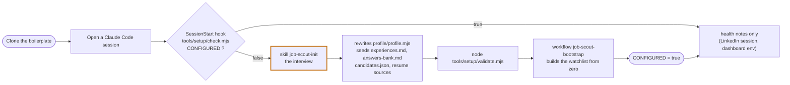
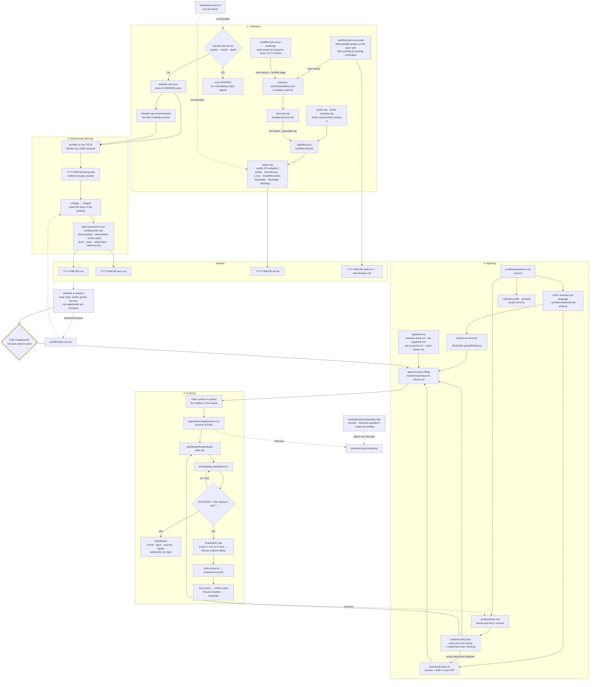

# Job scout pipeline

From the collection of postings to the dashboard, in four stages: **collect, filter, apply, track**. Run by hand. Never applies on its own. The rules are in [`CLAUDE.md`](./CLAUDE.md), the reasons in [`docs/LESSONS.md`](./docs/LESSONS.md).

## 0. First launch: the setup interview

The interview is the only step that turns this template into someone's search: the candidate answers, the agent writes. Until it is done, every session reminds it.

## 1. Architecture

### Reading the diagram

- **Discovery loop**: the web and bootstrap workflows find new names and propose them for `candidates.json`. `discover.mjs --promote` moves the ones with a live board into `watchlist.json`, which the poller then watches for good. Each pass permanently widens what the poller covers, and a slug already tried in vain is not probed again, so passes get shorter.
- **Two guards**: `doctor` skips the LinkedIn scan when an endpoint is dead, because an empty digest looks like a quiet week. The dump is written to a `.partial` file and replaces the old one only on success.
- **Dashboard deploy**: good only with `SUCCESS` on the host and the URL answering `401` (Basic auth, so it serves). A `404` means it is down.
- **Evaluation loop**: every free text is traced in `evals/records.jsonl` and checked by `evals/check.mjs` before the candidate sees it, then scored in the Evaluations tab. Scores come back into the repo through `pull-scores.sh` and turn into rules. The scores database lives on a volume, or each deploy wipes it. Spec in [`evals/README.md`](./evals/README.md).
- **Dotted arrows**: orchestration or side use, not data flow.

## 2. A pass, step by step

What happens when the candidate says « run the pipeline » or « look for offers » in a session. The orange nodes are the candidate's: choosing what to send, validating or correcting the free texts, clicking LinkedIn Easy Apply, and scoring the texts afterwards.

```mermaid
flowchart TD
    START(["« run the pipeline »<br/>or « look for offers »"]) --> SK["0. The agent loads the job-scout skill<br/>+ CLAUDE.md (automatic)"]
    ALT(["or: ./tools/daily-scan.sh"]) -.does 2 to 3 in one go.-> DOC

    SK --> MAILR["1. INBOX REVIEW FIRST<br/>in context, by ATS sender domain<br/>replies · rejections · interview slots"]
    MAILR --> CTX["Context<br/>applications.csv: where each company stands<br/>last digest + analysis: seen, dropped"]

    subgraph P2["2. Collect"]
        direction TB
        DOC{"linkedin.mjs doctor<br/>session · search · detail"}
        AUTH["launch-chrome.sh<br/>then linkedin.mjs auth"]
        DERIV["decoration dead:<br/>re-derive the client, STOP"]
        SCAN["linkedin.mjs scan<br/>title prefilter, then body read"]
        RECO["linkedin.mjs recommended"]
        ATS["watch.mjs<br/>reqs new since .seen.json<br/>read the ERROR line"]
        OPT["when useful:<br/>discover.mjs --promote (weekly)<br/>workflow job-scout-web (open web)"]
        DOC -->|"session KO"| AUTH --> DOC
        DOC -->|"endpoint KO"| DERIV
        DOC -->|OK| SCAN --> RECO
    end

    CTX --> DOC
    CTX --> ATS
    CTX -.-> OPT

    subgraph P3["3. Triage: triage(), deterministic"]
        direction TB
        DEDUP["dedup<br/>job ids seen + companies in the tracker"]
        HARD["hard exclusions<br/>adjacent function · intermediary · closed stack<br/>dead posting · too junior · lead tier<br/>years ≥ drop · band top under the floor · ruled out"]
        SIG["signals, never exclusions<br/>senior title · no band · many applicants<br/>abroad · ambiguous years floor · agnostic stack"]
        OUT["dump JSON + DATE.csv / DATE-reco.csv<br/>verdict and pourquoi left EMPTY"]
        DEDUP --> HARD --> SIG --> OUT
        OUT -.->|"tune a body filter"| RT["retriage dump.json<br/>zero requests"]
    end

    SCAN --> DEDUP
    RECO --> DEDUP

    subgraph P4["4. Judge, in session"]
        direction TB
        READ["the agent reads each survivor's body<br/>minimum qualifications, real stack, band<br/>form questions: video, contract, level"]
        VERD["verdict: candidater · lire · écarter<br/>pourquoi = a quoted line of the body<br/>a drop cites a pipeline rule"]
        RULED["structural closure<br/>→ profile/ruled-out.mjs"]
        ANA["DATE-analyse.md<br/>+ tally of drop reasons"]
        READ --> VERD --> ANA
        VERD -.-> RULED
    end

    OUT --> READ
    ATS --> READ
    OPT -.-> READ

    ANA --> PICK{"THE CANDIDATE<br/>chooses what to send"}
    PICK -->|"nothing"| STOPR(["end: progress.md + commit"])

    subgraph P5["5. Apply, one posting at a time"]
        direction TB
        LIVE{"posting still live on its ATS?<br/>no application at this company?"}
        TXT["free texts: stories from profile/stories.md<br/>a record in evals/records.jsonl<br/>check.mjs at 0 before showing them"]
        VAL{"THE CANDIDATE validates<br/>or corrects the texts"}
        CVSTEP["resume in the posting's language<br/>cv-to-send.sh → RESUME.uploadFileName<br/>build-letter.sh when no letter field"]
        ACC["candidate account if the ATS demands one<br/>(an account is not an application)"]
        FILL["agent-browser<br/>cookies first · map ALL fields<br/>checkboxes and selects · uploads · text LAST"]
        REREAD["full re-read of the form in the DOM"]
        EA{"LinkedIn Easy Apply?"}
        SUBMIT["one single send click<br/>(RULES.submittedBy)"]
        YOU["THE CANDIDATE clicks"]
        MAIL["read the response body<br/>then the mailbox is the oracle"]
        LIVE -->|yes| TXT --> VAL --> CVSTEP --> ACC --> FILL --> REREAD --> EA
        EA -->|no| SUBMIT --> MAIL
        EA -->|yes| YOU --> MAIL
    end

    PICK -->|"one or more"| LIVE
    LIVE -->|no| SKIPO["posting skipped, noted"]

    subgraph P6["6. Track"]
        direction TB
        CSV["row in applications.csv<br/>cv_version, what was filled<br/>(logged even if it seemed to fail)<br/>+ final and status sent in records.jsonl"]
        DEP["build-data.mjs then deploy-dashboard.sh"]
        OK{"host SUCCESS<br/>and URL answers 401?"}
        PROG["progress.md<br/>+ new recipe in ats-playbook.md<br/>commit + push"]
        CSV --> DEP --> OK
        OK -->|no| DEP
        OK -->|yes| PROG
    end

    MAIL --> CSV

    PROG --> LATER["Later: inbox review in context<br/>rejection → real reason written · interview → interview-prep/company<br/>chasers only if RULES.followUps allows"]
    PROG --> SCORE["Whenever: the Evaluations tab<br/>the candidate scores, pull-scores.sh, rules updated"]

    classDef human stroke:#c7771f,stroke-width:3px
    class PICK,YOU,VAL,SCORE human
```

## Cadence

| What | When | Cost |
|---|---|---|
| Inbox review | start of every session | minutes |
| `tools/daily-scan.sh` (poller + LinkedIn) | when the candidate decides, typically daily or weekly | free (ATS) · ~25 min of paced requests (LinkedIn) |
| `tools/weekly-discover.sh` | weekly | free, slow (hours), run in the background |
| workflow `job-scout-web` | weekly, or on a targeted need | tokens |
| workflow `job-scout-bootstrap` | at setup, then every 2 to 3 months ([`docs/METHOD.md`](./docs/METHOD.md)) | tokens, the most expensive |
| `glassdoor.mjs brief` | before an interview | a browser must run |
| Scoring the free texts (Evaluations tab), then `tools/pull-scores.sh` | whenever the candidate likes; pull before revising the writing rules | minutes |
