# The dashboard, page by page

The dashboard is the window on the two things this repo tracks: **where the search stands** (read from `applications/applications.csv`, never written) and **how good the texts written for you are** (read from `evals/records.jsonl`, scored by you). It runs on Bun, behind HTTP Basic auth, and works on a phone as well as on a laptop.

Every screenshot below comes from the **demo mode**: a fictional tracker of 37 applications at invented companies, 15 fictional free texts and a few scores. Nothing in them is real. Run it yourself with `cd dashboard && bun install && bun run demo`.

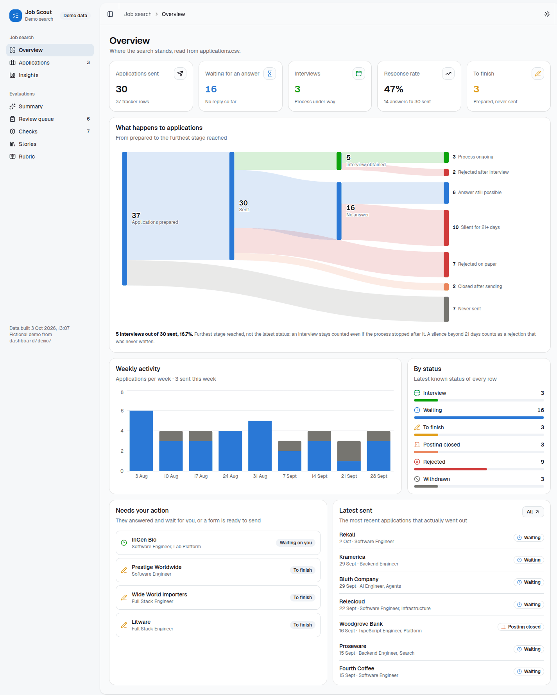

- [Run it](#run-it)
- [Job search: Overview](#overview), [Applications](#applications), [Insights](#insights)
- [Evaluations: Summary](#summary), [Review queue](#review-queue), [Checks](#checks), [Stories](#stories), [Rubric](#rubric)
- [On a phone](#on-a-phone)
- [Demo mode](#demo-mode)
- [Where each page reads its data](#where-each-page-reads-its-data)

## Run it

| You want | Run, from `dashboard/` |
|---|---|
| A first look, on fictional data | `bun run demo`, then open the URL it prints with the login and password it prints |
| Your own tracker, read only, live reload | `bun dev` (http://127.0.0.1:5180) |
| Your own data with scoring | `bun run build && DASHBOARD_PASSWORD=<12+ characters> SCORES_DB=/tmp/scores.sqlite bun server.ts` |
| `bun dev` with scoring against your deployed dashboard | `DASHBOARD_URL=https://<your-dashboard> DASHBOARD_PASSWORD=<its password> bun dev` |
| Deployed | `tools/deploy-dashboard.sh --detach`, see [`dashboard/README.md`](../dashboard/README.md) |

The sidebar holds both halves. On a laptop it collapses to icons (the button left of the page title, or `Ctrl+B` / `Cmd+B`); on a phone it becomes a drawer. The sun and moon button at the top right picks light, dark or the system theme. Badges in the sidebar count what waits for you: forms prepared but not sent, texts not scored yet, texts failing their checks.

## Job search

### Overview

**Answers: where does the search stand today, and is anything waiting for me?**

- **The five tiles**: applications really sent (rows marked `NEVER SENT`, `to_finish` and `withdrawn` excluded), how many still wait for an answer, interviews under way, the response rate (any answer, rejection included, over what was sent), and forms prepared but never sent.
- **What happens to applications** is the funnel, the one block that shows the **conversion rate to interview**. It reads the furthest stage reached, not the last status: an application rejected after an interview stays counted as an interview, because its note says `INTERVIEW OBTAINED`. A silence of more than 21 days moves to "Silent for 21+ days", a rejection nobody wrote. Hover a ribbon or a bar for its definition.
- **Weekly activity**: one bar per week, blue for what went out, grey for rows that never did. A grey week is a week of preparation that produced nothing; a gap is a week without a search.
- **By status**: every row by its latest status. Each status has an icon and a label, colour only reinforces.
- **Needs your action** is the list to read first. "Waiting on you" means a company answered and waits for you (the note says `WAITING FOR MY REPLY`): that is not a chaser, answer it. "To finish" is a form ready but not sent. A "Chaser due" line exists only if `RULES.followUps` in your profile is a number of days; with the default policy (`'never'`) it never shows.
- **Latest sent**: the last applications that really went out, with their status.

### Applications

**Answers: what exactly did I send, where, and what happened?**

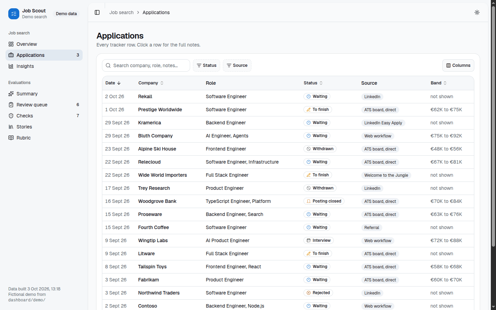

Click any row to open its side panel, with the full notes and every free text written for that application:

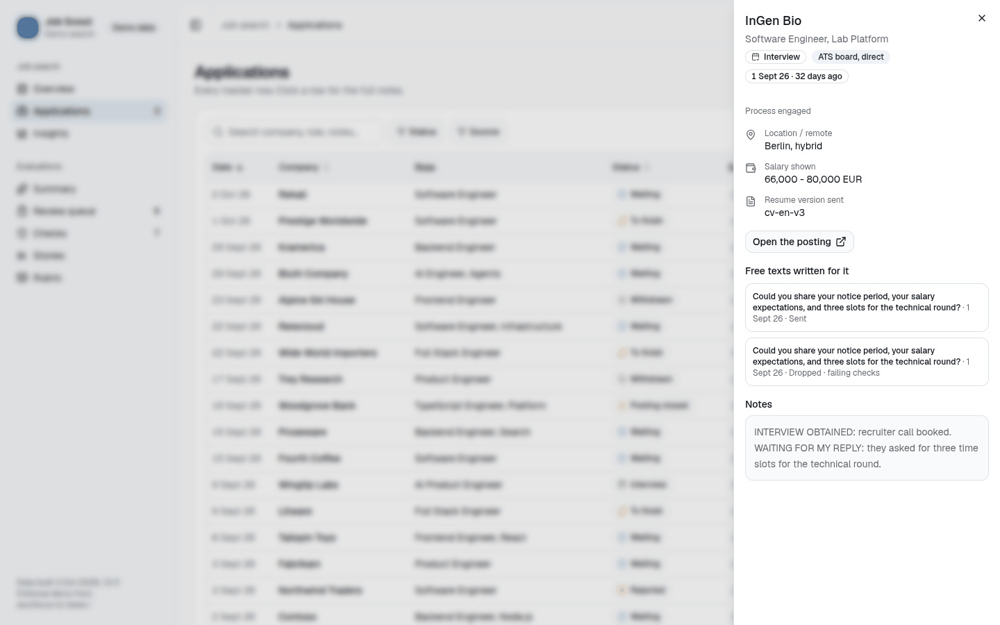

Every tracker row, newest first, 20 per page. Search matches the company, the role and the notes. **Status** and **Source** filter on several values at once; **Reset** clears them. **Columns** hides or shows columns on a laptop; on a phone the role moves under the company name.

Click a row for the side panel: status and its meaning, source family, date and age, location, the salary as the posting wrote it, the resume version sent, a link to the posting, **the free texts written for that company** (each one opens in the review queue), and the full notes.

The source column is a family, not the raw text of the `source` column: "Ashby, watchlist" and "Greenhouse, discover" both read "ATS board, direct". The grouping lives in `sourceFamily()` of `dashboard/scripts/build-data.mjs`.

### Insights

**Answers: which channels pay off, how steady is the pace, and what do postings pay?**

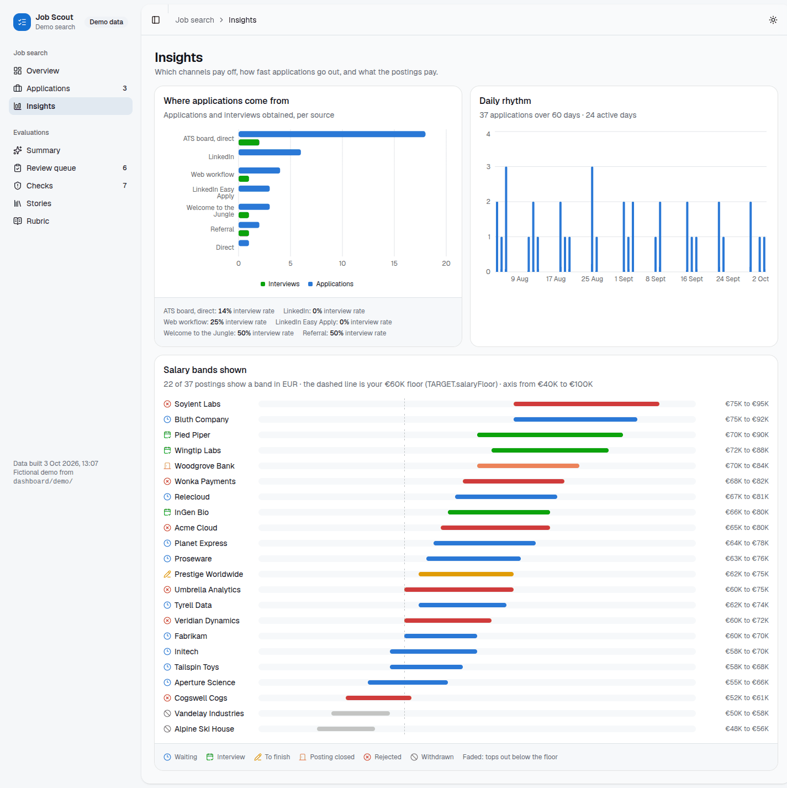

- **Where applications come from**: applications and interviews per source family, with the interview rate of each under the chart. A source that brings volume and no interview is a source to spend less time on.
- **Daily rhythm**: one bar per day, to see the bursts and the gaps.
- **Salary bands shown**: every posting that displayed a band in your currency (`TARGET.currency`), against **your floor**, the dashed line, read from `TARGET.salaryFloor` in your profile. A band that tops out below the floor is faded. The axis starts near the lowest band, so the bands stay comparable; the range is written in the card's description. Bands in another currency are left out rather than drawn on a wrong scale.

## Evaluations

Every free text the agent writes for you (an ATS field, a cover letter, an application mail, a reply to a recruiter, a LinkedIn message) is traced in `evals/records.jsonl` and checked by `evals/check.mjs` **before** you see it. These pages are where you read and score them. The method behind it is in [`evals/README.md`](../evals/README.md).

### Summary

**Answers: are the texts getting better, and what should the next rule be?**

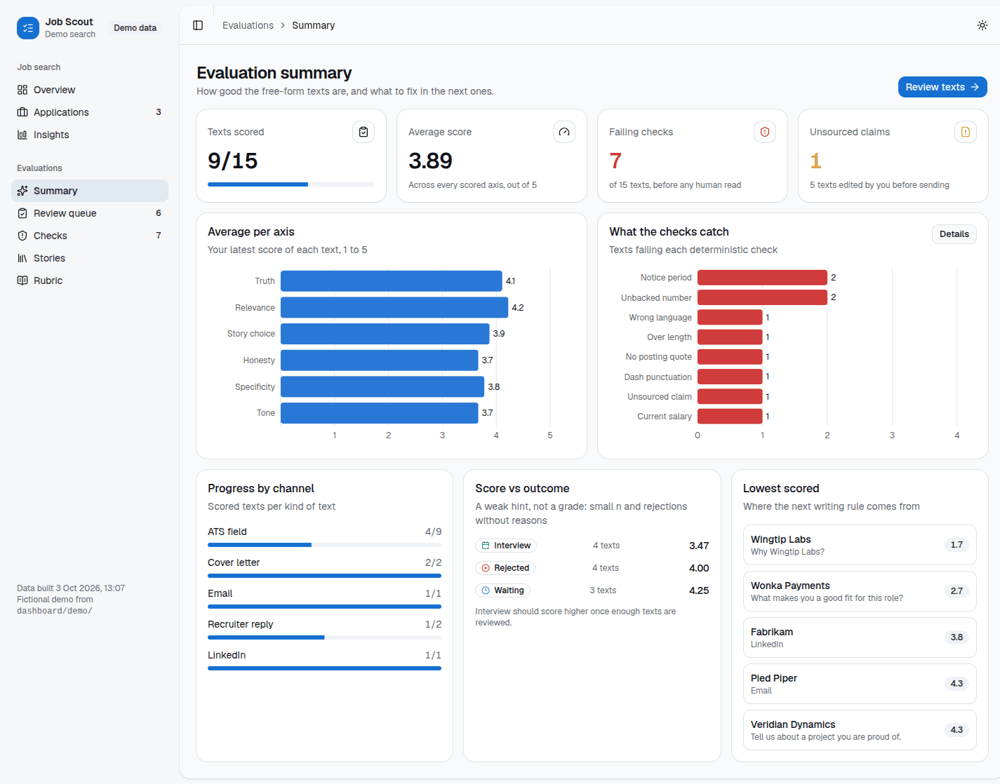

- **Tiles**: texts scored out of all texts, the average of every scored axis, texts failing at least one check, and claims whose source is not in the story catalogue (plus how many texts you edited before sending).
- **Average per axis**: your latest score of each text, axis by axis. The lowest bar is the next thing to write a rule about.
- **What the checks catch**: how many texts fail each kind of check. "Details" opens the Checks page.
- **Progress by channel**: scored texts per kind of text.
- **Score vs outcome**: the average score of texts sent to companies now in interview, rejected, or silent. Read it as a hint, never as a grade: the numbers are small and rejections rarely give a reason.
- **Lowest scored**: the five weakest texts, one click from the review queue. This is where the next written rule comes from.

### Review queue

**Answers: is this text good enough, and why not?** This is the page you work in.

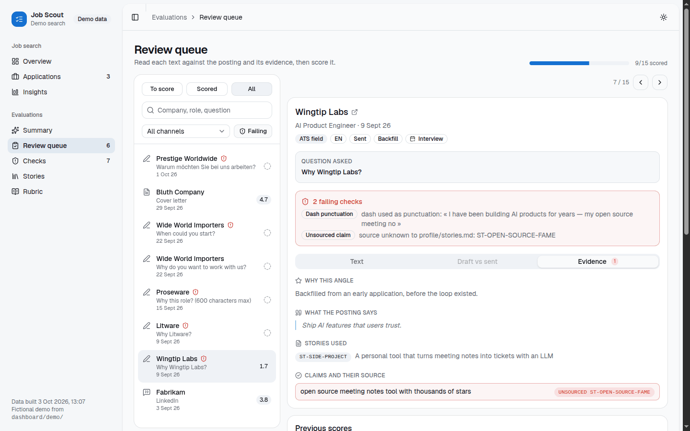

**The queue (left)**

- **To score / Scored / All**: what is left, what you already did, everything.
- **Search**: company, role or question.
- **All channels**: only ATS fields, letters, mails, recruiter replies or LinkedIn messages.
- **Failing**: only texts that fail a check.
- Each line shows the channel icon, the company, the question, the date, a red shield when a check fails, and your latest average once scored (a dashed circle until then).

**The text (right)**

- The header gives the company (linked to the posting), the role and date, then badges: channel, language, text status (draft, sent, dropped), origin (live, or backfill for texts written before the loop existed), **the application's status read from the tracker**, and "Edited before sending" when what went out differs from the draft.
- **Question asked**: the exact question of the form or the recruiter.
- **Failing checks**: each failure with its family ("Dash punctuation", "Unsourced claim", "Current salary", "Notice period", "Over length", "Wrong language", "Unbacked number", "No posting quote") and the checker's own message.
- Three tabs:
  - **Text**: what went out (or the draft, if nothing went out), with a length meter against the field's limit.
  - **Draft vs sent**: removed words struck in red, added words in green. Every edit you made is a free label: it says exactly what the agent got wrong. The tab is disabled when you sent the draft as is.
  - **Evidence**: why this angle, the lines of the posting the text rests on, the stories used (with their title from the catalogue), and every claim with its source id. A claim whose source is not in `profile/stories.md` is marked `UNSOURCED`.

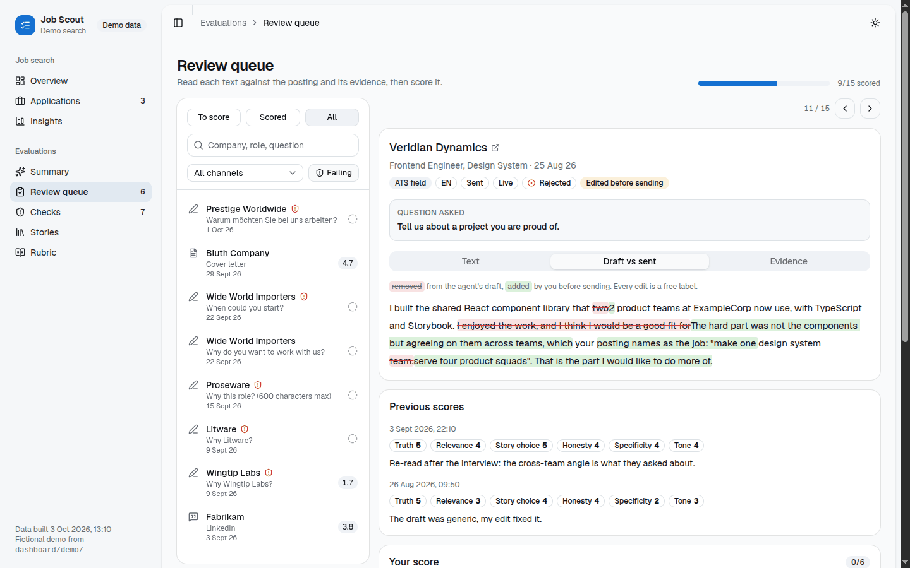

**Scoring**

1. Read the text, then the evidence. Ask the six questions of the rubric: **Truth** (is everything true and defensible in an interview?), **Relevance** (does it answer this question for this posting?), **Story choice** (was it the right story?), **Honesty** (are real gaps owned without self-sabotage?), **Specificity** (could it go to another company unchanged?), **Tone** (does it sound like you?).
2. Click 1 to 5 on each axis. Leave an axis empty to skip it; click the selected value again to clear it.
3. Write a **comment** when something is wrong: which story would have worked better, which sentence is false. Optionally open **Write your own version**: a rewrite becomes a reference example the agent reads before writing the next text.
4. **Save & next** saves and opens the next text of the queue; **Save** stays on this one. A toast confirms. Scoring a text again adds a new score: the latest one counts in every average, the older ones stay listed under **Previous scores**.

**Keyboard**: `j` or `→` opens the next text of the queue, `k` or `←` the previous one (not while typing in a field). On a narrow screen the queue and the text are two views: **Queue** goes back to the list.

When the scores API does not answer (plain `bun dev`, or a server down), a banner says so and the save buttons stay disabled: the texts remain readable.

**Where the scores go.** Each save is one row in the server's SQLite database (`SCORES_DB`, append only). On Railway that file must live on a volume, or every deploy wipes it (see [`evals/README.md`](../evals/README.md)). `tools/pull-scores.sh` copies every score into `evals/scores.jsonl`, committed, so git keeps the history and the future LLM judge can calibrate on it. Run it before revising the writing rules. Low scores become written rules (`applications/answers-bank.md`, `CLAUDE.md`, the « Known don'ts » of `profile/stories.md`); 5/5 texts and rewrites become examples.

### Checks

**Answers: what does the deterministic layer block, and where?**

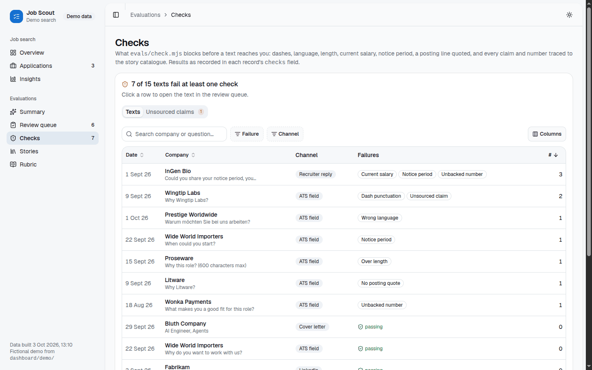

The **Texts** tab lists every text with its failure families and their count, most failures first. Filter by failure or channel; click a row to open the text in the review queue. The **Unsourced claims** tab lists every claim whose source id is not in the catalogue, with the id that was given: each one is either a gap in `profile/stories.md` (add the row, with its source, once you validated it) or a fabrication (score its truth 1 and add it to the known don'ts).

The results are the `checks` field each record carries, written by `node evals/check.mjs --write`. The page shows them; it does not run the checker.

### Stories

**Answers: which stories carry the texts, and which ones should be rewritten or retired?**

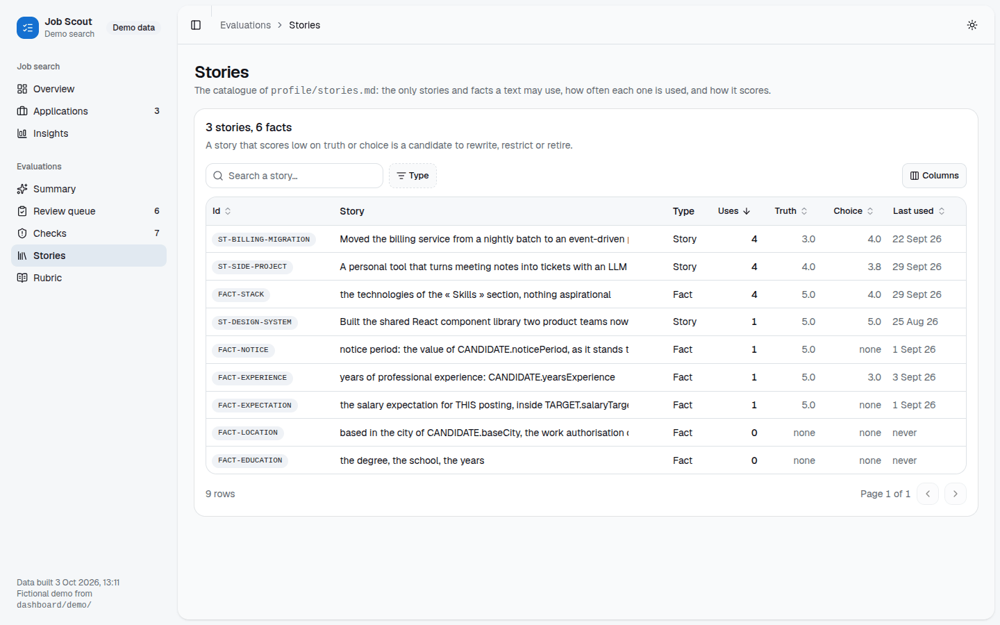

The catalogue of `profile/stories.md`, one row per story or fact: how many texts use it, the average **Truth** and **Story choice** scores of those texts, and when it was last used. Click a row for what it proves, its citable facts, its source in your canon, and every text that used it. A story that scores low on truth or choice is a candidate to rewrite, to restrict to some questions, or to retire.

### Rubric

The six axes with their questions, the three layers (deterministic checks, your scores, a calibrated judge later and never on truth) and the loop, on one page to keep open while scoring.

## On a phone

  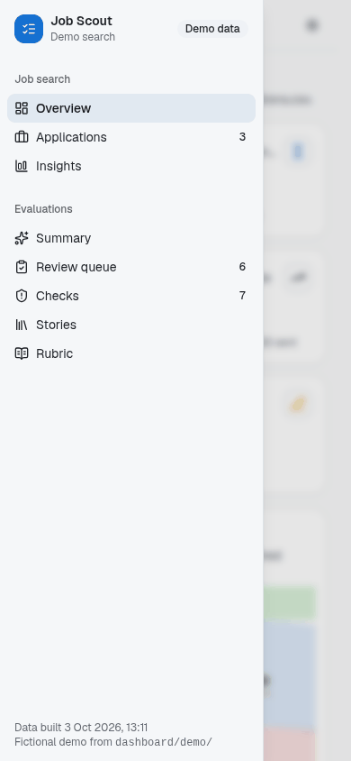
  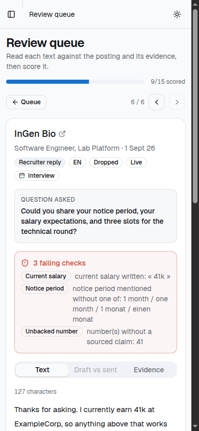

The page never scrolls sideways: wide blocks (the funnel, the tables) scroll inside their own card. The sidebar is a drawer, opened by the button at the top left and closed by any navigation. In the review queue the score buttons take the full width under each axis.

## Demo mode

`bun run demo` (in `dashboard/`) is the way to see everything above without a single real row.

- **Inputs**: it builds with `DASHBOARD_DEMO=1`, which makes `scripts/build-data.mjs` read `dashboard/demo/` only: `applications.csv` (37 fictional applications at invented companies, over two months), `records.jsonl` (15 fictional texts, 7 of them failing a check, 5 edited before sending), `stories.md` (a copy of the example catalogue, so the demo keeps working after the onboarding rewrites yours) and `profile.mjs` (title, locale, currency, floor). Your tracker, records, catalogue and profile are not opened.
- **Scores**: it creates a fresh SQLite file in a temporary directory, seeds it from `demo/scores.jsonl` (11 fictional scores, one of them by the judge), and forces `SCORES_DB` to it whatever your environment says. Scores you add while playing go there too. The directory is deleted when the server stops (`Ctrl+C`).
- **Dates** are shifted so the newest demo row is yesterday: the demo reads the same whenever you run it.
- **Login**: user `demo`, and a random password printed at startup, unless `DASHBOARD_USER` / `DASHBOARD_PASSWORD` are set. `PORT` defaults to 8080. `bun run demo --skip-build` serves the last demo build again.
- The sidebar shows a **Demo data** badge, and the tab title says "(demo)".
- `bun run dev:demo` runs the Vite dev server on the demo data (read only, no scores API).

⚠️ The demo writes the usual generated files (`src/data/*.json`, `dist/`) with demo data. Run `bun run build` (or `bun run data`) before serving your own data again. A deploy is not affected: the container always builds from your real files, and `tools/deploy-dashboard.sh` does not ship `dashboard/demo/`.

To change the demo, edit the files of `dashboard/demo/`, then rerun the checks on the records so their `checks` field stays true: `node evals/check.mjs --file dashboard/demo/records.jsonl --write` (with the example profile still in place).

## Where each page reads its data

| Input | Read by | Written by |
|---|---|---|
| `applications/applications.csv` | Overview, Applications, Insights, and the application status shown next to each text | you and the agent, one row per application |
| `profile/profile.mjs` | title, locale, currency, salary floor, chaser policy, login | the onboarding, then you |
| `evals/records.jsonl` | every Evaluations page | the agent only, `checks` by `evals/check.mjs --write` |
| `profile/stories.md` | Stories, story titles in the evidence tab, unsourced claims | the onboarding, validated by you |
| SQLite at `SCORES_DB` | scores everywhere | the review queue only |
| `evals/scores.jsonl` | nothing in the page: the git mirror of the scores | `tools/pull-scores.sh` |

The CSV, the records and the catalogue are baked into the page at build time (`scripts/build-data.mjs`), which is why every write to the tracker ends with a rebuild and a deploy.
